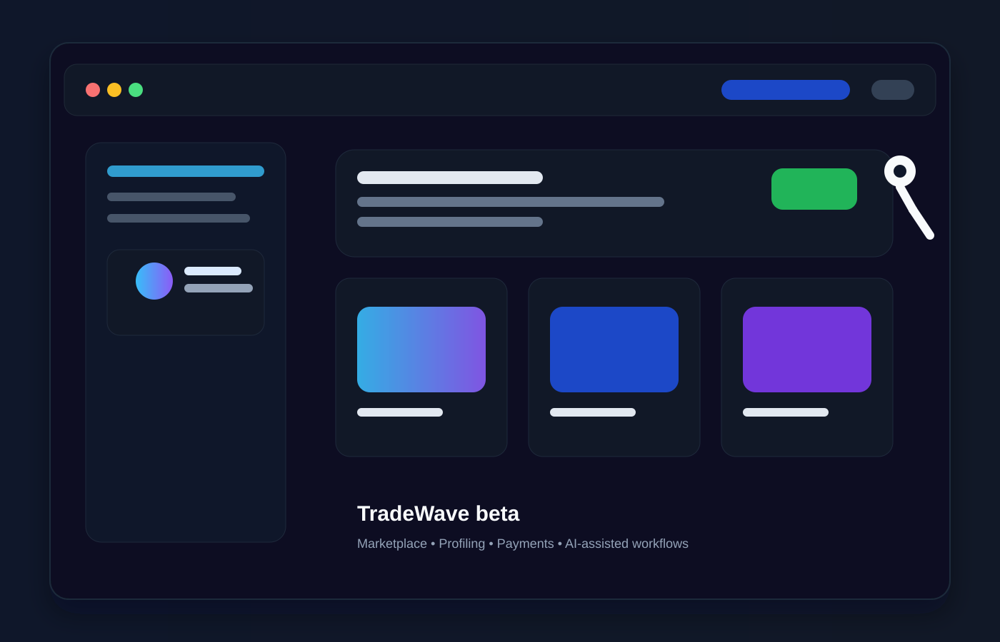

# TradeWave WebApp

A beta product platform and marketplace concept for creators, buyers, and teams.

Status: Early beta / production concept with pending polish and contributor onboarding.

Overview
TradeWave is designed around a creator and marketplace model: profiles, bidding, project workflows, payments, AI-assisted features, and multi-user collaboration.

This repository is the canonical implementation for the TradeWave project and includes the most complete, current app structure available from the project set.

Highlights
- Modern frontend and backend app structure
- Marketplace and profile flows
- Payment-ready architecture
- AI and analytics concept layers
- Deployment guidance and testing artifacts

Repository guidance
- Canonical app: TradeWave_WebApp
- Supporting historical docs: docs/legacy
- License: LICENSE
- Ownership: OWNERSHIP.md
- Commercial agreement: COMMERCIAL_USE_AGREEMENT.md
- Contributing: CONTRIBUTING.md

Showcase
The project is in beta and benefits from a polished showcase. We have included an interactive-style mockup below to communicate the look and feel while the project is still in active iteration.

Quick start
1. Clone the repository.
2. Frontend:
   cd frontend
   npm install
   npm start
3. Backend:
   cd backend
   pip install -r requirements.txt
   python -m uvicorn server:app --reload

If your project layout differs, use the deployment guide in `DEPLOYMENT_GUIDE.md` as the canonical configuration reference.

Project docs
- DEPLOYMENT_GUIDE.md
- README.md
- docs/legacy/TRADEWAVE_FEATURES.md
- docs/legacy/TRADEWAVE_PLANNING.md
- docs/legacy/TRADEWAVE_RULES.md

Contact
- Email: steurbautwaya703@gmail.com
- Owner: Waya Steurbaut / Wayacreate Studios
